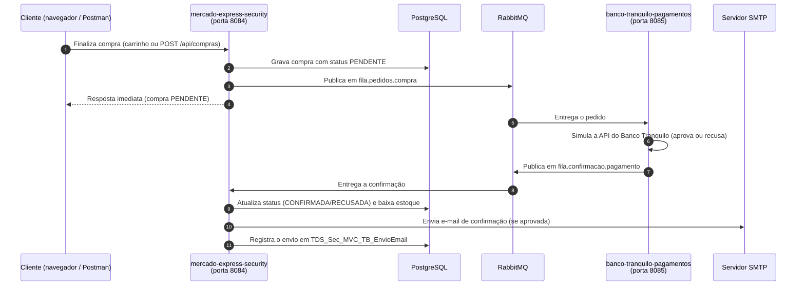

# Mercado Express + Banco Tranquilo — Compras assíncronas com RabbitMQ

**FIAP — Tecnologia em Análise e Desenvolvimento de Sistemas (TDS)**
**Atividade:** Checkpoint 5 — Parte 2 (mensageria com RabbitMQ)
**Professor:** Dr. Marcel Stefan Wagner

**Integrante:**
- Gabriel Cabral Mendes Mariano — RM 563230

**IDE utilizada:** IntelliJ IDEA
**Deploy:** não se aplica a esta parte (execução local)

---

## 1. Visão geral

O **Mercado Express** passou a processar compras de forma **assíncrona**. Quando o cliente finaliza o carrinho, o pedido é gravado como `PENDENTE` e publicado numa fila do **RabbitMQ**. Um segundo projeto, o **Banco Tranquilo Pagamentos** (microsserviço independente), consome o pedido, simula a integração com a API de pagamentos do banco e devolve o resultado por outra fila. Ao receber a confirmação, o Mercado Express:

1. atualiza a compra para `CONFIRMADA` (ou `RECUSADA`);
2. baixa o estoque do produto (somente quando confirmada);
3. envia um **e-mail de confirmação** ao cliente e registra o envio no banco (**log de e-mails**);
4. alimenta o **dashboard da gerência** (vendas, lucro e estoque).

O projeto reaproveita a aplicação da Parte 1 (Spring Security + Thymeleaf + PostgreSQL), acrescentando carrinho, compras, mensageria, e-mail, dashboard e uma API REST para testes.

## 2. Arquitetura e fluxo



### Filas, exchange e mensagens

| Item | Nome | Produtor | Consumidor |
|---|---|---|---|
| Exchange (direct) | `mercado.express.exchange` | — | — |
| Fila de pedidos | `fila.pedidos.compra` (routing key `pedido.compra`) | mercado-express-security | banco-tranquilo-pagamentos |
| Fila de confirmações | `fila.confirmacao.pagamento` (routing key `confirmacao.pagamento`) | banco-tranquilo-pagamentos | mercado-express-security |

As mensagens trafegam como **JSON** (`Jackson2JsonMessageConverter`).

Pedido (`fila.pedidos.compra`):

```json
{
  "compraId": 1,
  "produtoNome": "Café Torrado e Moído Premium",
  "quantidade": 2,
  "valorTotal": 49.8,
  "nomeComprador": "Gabriel Cabral",
  "emailComprador": "cliente@exemplo.com"
}
```

Confirmação (`fila.confirmacao.pagamento`):

```json
{
  "compraId": 1,
  "aprovado": true,
  "mensagem": "Pagamento aprovado pelo Banco Tranquilo."
}
```

> Os dois projetos são aplicações Java separadas, com pacotes diferentes. Por isso o conversor usa `TypePrecedence.INFERRED`: o tipo da mensagem é deduzido pelo parâmetro do método `@RabbitListener`, e não pelo nome da classe de quem enviou.

### Regras do "Banco Tranquilo" (simulado)

- Atraso artificial de 0,8 a 2,5 segundos, para a confirmação visivelmente não ser instantânea.
- **90%** dos pagamentos são aprovados e **10%** recusados de forma aleatória, para demonstrar os dois caminhos do fluxo.

## 3. Tecnologias

- Java 17, Spring Boot 4.1.0 (Spring Framework 7)
- Spring Security, Spring MVC + Thymeleaf, Spring Data JPA (Hibernate)
- Spring AMQP (RabbitMQ), Spring Mail
- PostgreSQL, Chart.js (dashboard), Lombok
- Docker (RabbitMQ com o Management Dashboard), Postman

## 4. Estrutura do repositório

```
.
├── docker-compose.yml                  # RabbitMQ + Management Dashboard
├── mercado-express-security/           # Aplicação principal (porta 8084)
│   └── src/main/java/.../
│       ├── config/                     # SecurityConfig, AdminSeeder, handler de login por role
│       ├── controller/                 # Web (MVC), carrinho, dashboard e API REST /api/compras
│       ├── messaging/                  # RabbitMQConfig, mensagens e listener de confirmação
│       ├── service/                    # CompraService (publica o pedido) e EmailService
│       └── model/                      # Mercado, Usuario, Compra, EnvioEmail
├── banco-tranquilo-pagamentos/         # Microsserviço de pagamentos (porta 8085)
│   └── src/main/java/.../
│       ├── messaging/                  # RabbitMQConfig, mensagens e listener de pedidos
│       └── service/                    # IntegracaoPagamentoService (simula o banco)
└── postman/
    └── CP5-Mercado-Express.postman_collection.json
```

## 5. Como executar

### Pré-requisitos

JDK 17, Maven (ou a IDE), Docker Desktop e um banco PostgreSQL acessível.

### Passo 1 — Subir o RabbitMQ

Na raiz do repositório:

```bash
docker compose up -d
docker ps
```

O container `rabbitmq-mercado-express` deve aparecer como `Up`. O painel de gerenciamento fica em **http://localhost:15672** (usuário `guest`, senha `guest`).

### Passo 2 — Configurar as variáveis de ambiente do `mercado-express-security`

O `application.yml` não contém nenhuma credencial; tudo vem de variáveis de ambiente (na IDE: *Run Configuration → Environment variables*).

| Variável | Obrigatória | Descrição / valor padrão |
|---|---|---|
| `DB_URL` | sim | `jdbc:postgresql://HOST:5432/BANCO` (use `?sslmode=require` em bancos na nuvem) |
| `DB_USERNAME` | sim | Usuário do PostgreSQL |
| `DB_PASSWORD` | sim | Senha do PostgreSQL |
| `RABBITMQ_HOST` / `RABBITMQ_PORT` | não | `localhost` / `5672` |
| `RABBITMQ_USERNAME` / `RABBITMQ_PASSWORD` | não | `guest` / `guest` |
| `MAIL_HOST` / `MAIL_PORT` | não | Padrão: sandbox do Mailtrap (`sandbox.smtp.mailtrap.io` / `2525`). Para envio real via Office365: `smtp.office365.com` / `587` |
| `MAIL_USERNAME` / `MAIL_PASSWORD` | não* | Credenciais do servidor SMTP |
| `MAIL_REMETENTE` | não | Remetente do e-mail (no Office365, deve ser o mesmo e-mail de `MAIL_USERNAME`) |
| `ADMIN_EMAIL` / `ADMIN_PASSWORD` / `ADMIN_NOME` | não | `admin@mercadoexpress.com` / `admin123` / `Administrador` |
| `PORT` | não | `8084` |

\* Sem usuário/senha de SMTP a aplicação sobe normalmente, mas o envio do e-mail é registrado como `FALHA` no log de e-mails.

O `banco-tranquilo-pagamentos` só precisa do RabbitMQ (os valores padrão já apontam para o Docker local). Um exemplo comentado das variáveis está em `mercado-express-security/src/main/resources/application.yml.example`.

### Passo 3 — Executar as duas aplicações

Rode `MercadoExpressSecurityApplication` (porta **8084**) e `BancoTranquiloPagamentosApplication` (porta **8085**). Em linha de comando, em cada pasta: `mvn spring-boot:run`.

No painel do RabbitMQ, a aba **Queues** deve listar `fila.pedidos.compra` e `fila.confirmacao.pagamento`, cada uma com 1 consumer.

Na primeira inicialização é criado automaticamente o usuário administrador (`AdminSeeder`):

- **E-mail:** `admin@mercadoexpress.com`
- **Senha:** `admin123`

## 6. Como testar

### 6.1 Pela interface Web

1. Entre em http://localhost:8084/login como **admin**, abra **Novo produto** e cadastre um produto (nome, tipo, setor, tamanho, preço, **custo** e **estoque**).
2. Saia, crie uma conta em **Cadastre-se** (usuário comum, `ROLE_USER`) e entre.
3. No catálogo, clique em **Comprar** no produto (ele vai para o carrinho) e depois em **Finalizar compra**.
4. Em **Minhas compras** a compra aparece como `PENDENTE`; após 1 a 3 segundos, recarregue a página e o status muda para `CONFIRMADA` (ou `RECUSADA`).
5. Com a compra confirmada, confira o e-mail na caixa do comprador e o log do envio na tabela `TDS_Sec_MVC_TB_EnvioEmail`.
6. Entre como **admin** e abra **Dashboard** (`/admin/dashboard`): lista de compras, total vendido, lucro total e gráficos de vendas, lucro e estoque por produto.

### 6.2 Pela API REST (Postman / Insomnia)

Importe `postman/CP5-Mercado-Express.postman_collection.json`. A coleção tem 4 requisições e a variável `baseUrl` (`http://localhost:8084`); o `compraId` retornado pelo POST é guardado automaticamente para a consulta seguinte.

| # | Requisição | Resultado esperado |
|---|---|---|
| 1 | `POST /api/compras` | `201 Created`, compra com `status: PENDENTE` |
| 2 | `GET /api/compras/{id}` | Após alguns segundos: `CONFIRMADA` ou `RECUSADA` |
| 3 | `GET /api/compras` | Lista de todas as compras |
| 4 | `POST /api/compras` com produto inexistente | `404` com `{"erro": "Produto nao encontrado: ..."}` |

Exemplo de JSON de compra (o `produtoId` deve existir no catálogo):

```json
{
  "produtoId": 1,
  "quantidade": 2,
  "nomeComprador": "Gabriel Cabral",
  "emailComprador": "cliente@exemplo.com"
}
```

Com `curl`:

```bash
curl -X POST http://localhost:8084/api/compras \
  -H "Content-Type: application/json" \
  -d '{"produtoId":1,"quantidade":2,"nomeComprador":"Gabriel Cabral","emailComprador":"cliente@exemplo.com"}'
```

### 6.3 Pelo painel do RabbitMQ

Em http://localhost:15672:

- **Queues:** acompanhe as filas e a taxa de mensagens (*Message rates*).
- **Queues → fila.pedidos.compra → Publish message:** publique manualmente um JSON de pedido (formato da seção 2, com a propriedade `content_type` = `application/json`) para ver o `banco-tranquilo-pagamentos` consumi-lo e responder na outra fila. O `compraId` precisa existir na tabela de compras, senão o Mercado Express apenas registra um aviso no log.
- **Queues → Get messages:** com os consumers parados, as mensagens ficam acumuladas e podem ser inspecionadas.

## 7. Banco de dados

| Tabela | Conteúdo |
|---|---|
| `TDS_Users_Mercado` | Usuários e roles (`ROLE_ADMIN` / `ROLE_USER`), senha com hash BCrypt |
| `TDS_Sec_MVC_TB_Mercado` | Catálogo de produtos (preço, custo e estoque) |
| `TDS_Sec_MVC_TB_Compra` | Compras e status (`PENDENTE`, `CONFIRMADA`, `RECUSADA`) |
| `TDS_Sec_MVC_TB_EnvioEmail` | Log de e-mails: destinatário, assunto, corpo, status (`ENVIADO` / `FALHA`) e data |

As tabelas são criadas automaticamente pelo Hibernate (`ddl-auto: update`).

## 8. Controle de acesso

| Rota | Acesso |
|---|---|
| `/`, `/login`, `/cadastro`, `/mercado` (consulta) | Público |
| `/api/**` | Público (pensado para testes via Postman/Insomnia; CSRF desativado apenas neste prefixo) |
| `/carrinho/**`, `/minhas-compras`, `/area/**` | Usuário autenticado |
| `/admin/**` (painel, dashboard) e escrita no catálogo | Somente `ROLE_ADMIN` |

Após o login, `ROLE_ADMIN` é redirecionado para `/admin` e `ROLE_USER` para `/area`. O logout é feito por `POST /logout` (exigência do CSRF no Spring Security 7).

## 9. Observações

- O estoque só é baixado quando o pagamento é **confirmado**; compras recusadas não alteram o estoque.
- Se o `banco-tranquilo-pagamentos` estiver parado, os pedidos ficam acumulados na `fila.pedidos.compra` e são processados assim que ele voltar.
- Se o RabbitMQ estiver fora do ar, as aplicações sobem normalmente e reconectam sozinhas (nova tentativa a cada 5 segundos) quando ele voltar.
